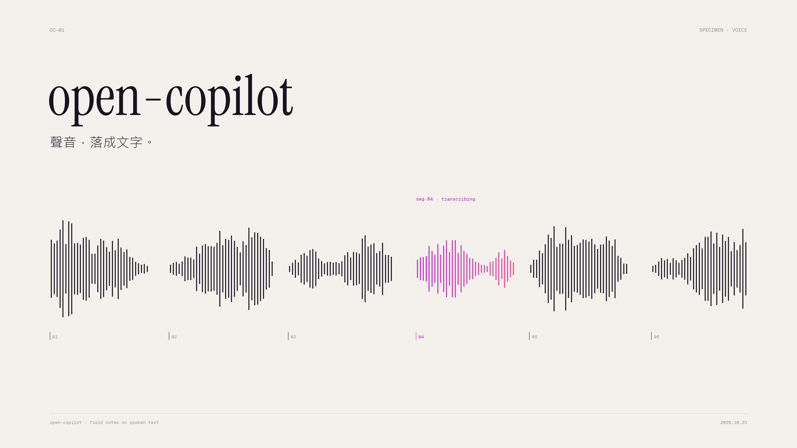
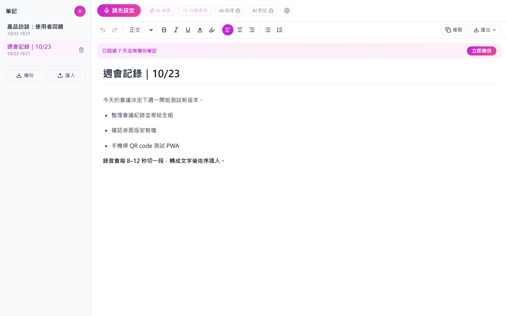
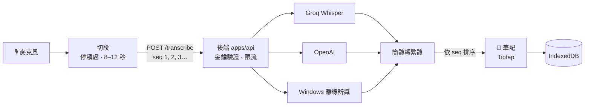

<div align="center">

# open-copilot 🎙️

**說出口的話，自動落成筆記。**<br>
執行 `npm run prototype`，按下「錄製」開始說話，說完的內容就會依序出現在筆記裡。

[](https://github.com/jaylooloomi/open-copilot/actions/workflows/ci.yml)




[快速開始](#-30-秒開始) · [功能](#-功能) · [運作方式](#-運作方式) · [轉寫服務](#-轉寫服務) · [手機與桌面](#-手機與桌面) · [常見問題](#-常見問題)

</div>

---

## ✨ 功能

|   | 功能 | 說明 |
|---|---|---|
| 🎙️ | **邊錄邊轉** | 每 8–12 秒在說話停頓處切一段送去轉寫，文字依段落順序插入筆記。錄音時照常打字也不會打亂插入位置。 |
| 🔁 | **轉寫失敗可重送** | 斷線或伺服器錯誤會自動重試；仍然失敗的段落會在筆記裡留一個「⚠ 未轉寫」標記，點一下就能重送。 |
| 📝 | **富文本編輯** | 標題層級、粗體、斜體、底線、字色、螢光筆、對齊、項目清單、編號清單、復原與重做。 |
| 📤 | **複製與匯出** | 可匯出 Markdown、Word（.docx）、純文字和 PDF；複製全文時會保留格式。 |
| 🤖 | **AI 摘要與待辦** | 一鍵產生摘要，或把內容整理成可勾選的待辦清單（使用 Groq 免費模型）。 |
| 💾 | **本機儲存與備份** | 筆記存在裝置本機（IndexedDB），可以匯出或匯入 JSON 備份；超過 7 天沒備份時會提醒。 |
| 📱 | **三個平台共用同一套程式碼** | 網頁（可安裝成 PWA）、Windows 桌面版（Electron）、Android App（Capacitor）。 |
| 🔌 | **不需要 API key 也能用** | 在 Windows 上沒有設定金鑰時，會自動改用系統內建的離線語音辨識。 |

## 📸 畫面

<p align="center">
  
  &nbsp;
  
</p>

## 🚀 30 秒開始

需要 Node 24（npm 11）。請在 repo 根目錄執行（Windows 用 Git Bash）：

```bash
npm install
npm run prototype
```

執行後會依序發生這些事：

1. 自動選擇轉寫服務，選擇規則見[轉寫服務](#-轉寫服務)。
2. 第一次執行時產生一把存取金鑰，存進 `apps/api/.env.local`（不會被 git 追蹤）。
3. 同時啟動後端 `http://localhost:8787` 和網頁 `http://localhost:5173`。
4. 自動開啟瀏覽器，後端網址和金鑰都已填好。這時就可以按「錄製」。

按 **Ctrl+C** 會同時關閉後端和網頁。

| 指令 | 用途 |
|---|---|
| `npm run prototype -- --no-open` | 不自動開瀏覽器，只印出網址 |
| `npm run prototype -- --check` | 確認後端和網頁都正常之後自動結束，用來檢查環境 |
| `npm run prototype -- --share` | 產生手機用的 HTTPS 網址和 QR code，見[手機與桌面](#-手機與桌面) |

> [!WARNING]
> 自動開啟的網址（`#oc-setup=...`）含有存取金鑰，請不要分享給別人。

## 🧠 運作方式



- 每段錄音都會帶序號，可以同時上傳，但一定依序插入筆記。
- 前一段的文字會當成提示詞一起送出，讓前後段接得比較順。
- 失敗會重試 3 次，間隔依序是 1 秒、2 秒、4 秒；遇到 429 會照 `Retry-After` 等待；仍然失敗的音訊會先存在本機，等你點標記重送。

## 🗣️ 轉寫服務

後端依以下順序選擇，先符合的優先：

| 順序 | 條件 | 使用的服務 | 備註 |
|---|---|---|---|
| 1 | 有設定 `TRANSCRIBE_PROVIDER` | 你指定的 `groq`／`openai`／`windows` | |
| 2 | 有 `GROQ_API_KEY` | Groq `whisper-large-v3-turbo` | **建議使用**，免費額度就夠用；AI 功能也需要這把金鑰 |
| 3 | 有 `OPENAI_API_KEY` | OpenAI `gpt-4o-mini-transcribe` | |
| 4 | 都沒有，而且是 Windows | Windows 內建 System.Speech（zh-TW） | 離線、免費，但**沒有標點**；需要 ffmpeg（`winget install Gyan.FFmpeg`） |

**改用 Groq：** 到 <https://console.groq.com/keys> 建立金鑰，在 `apps/api/.env.local` 加一行 `GROQ_API_KEY=<你的金鑰>`，再重新執行一次 `npm run prototype`。

完整的環境變數列表見 [apps/api/README.md](apps/api/README.md#環境變數)。

## 📱 手機與桌面

<details>
<summary><b>手機：分享網址（不需要帳號）</b></summary>

```bash
npm run prototype -- --share
```

1. 啟動器會先建置網頁，用 Cloudflare quick tunnel 把它公開成 `https://<隨機名稱>.trycloudflare.com`。
2. 終端機會印出 QR code，用手機相機掃描後設定會自動填好，可以直接錄音。

注意事項：

- **這個網址是公開的。** 只在測試時開啟，用完按 Ctrl+C 關閉。後端仍然需要存取金鑰才能使用。
- 每次執行產生的網址都不同，手機上的筆記只存在那個網址底下。要保留筆記，請在關閉前按「備份」匯出。
- 疑難排解見 [apps/web/README.md](apps/web/README.md)。

</details>

<details>
<summary><b>手機：安裝成 PWA 或 Android App</b></summary>

- **PWA**：用手機 Chrome 開啟 HTTPS 網址（上面的分享網址，或部署後的正式網址），在選單選「安裝應用程式」。要正式部署，見 [apps/web/README.md](apps/web/README.md#部署到-vercel)。
- **Android App**：需要 JDK 21 和 Android Studio。
  1. 執行 `npm run cap:sync -w @oc/web`。
  2. 執行 `npm run android:run -w @oc/web`。
  3. App 連的後端必須是 HTTPS。

  完整步驟見 [apps/web/README.md](apps/web/README.md#android-appcapacitor)。

</details>

<details>
<summary><b>Windows 桌面版</b></summary>

1. 建立安裝檔：

   ```bash
   npm run dist -w @oc/desktop
   ```

   產出的檔案是 `apps/desktop/release/open-copilot-setup-<版本>.exe`。安裝檔沒有簽章，SmartScreen 會跳出警告，點「其他資訊」→「仍要執行」即可。

2. 搭配本機後端使用：
   1. 先執行 `npm run prototype`。
   2. 打開桌面版的「設定」，「後端網址」填 `http://localhost:8787`。
   3. 「存取金鑰」填 `apps/api/.env.local` 裡 `ACCESS_KEYS=` 後面的值。

詳細說明見 [apps/desktop/README.md](apps/desktop/README.md)。

</details>

## 🗂️ 專案結構

```text
open-copilot/
├── packages/
│   ├── core/        所有畫面與邏輯（React + Tiptap），三個平台共用
│   └── shared/      前後端共用的 API 型別與限制
├── apps/
│   ├── web/         網頁入口、PWA、Android 專案（apps/web/android）
│   ├── api/         轉寫與 AI 後端（Hono + Node，可打包成 Docker image）
│   └── desktop/     Windows 桌面版（Electron）
├── scripts/
│   └── prototype.mjs   npm run prototype 一鍵啟動器
└── docs/superpowers/   設計規格與實作計畫
```

## 🛠️ 開發

| 指令 | 用途 |
|---|---|
| `npm test` | 執行所有 workspace 的單元測試 |
| `npm run typecheck` | 執行所有 workspace 的型別檢查 |
| `npm run test:workflow` | 測試 CI 設定和 `npm run prototype` 啟動器 |
| `npm run e2e` | 執行網頁端對端測試（Playwright）。第一次執行前，先跑 `npm exec -w @oc/web -- playwright install chromium` |
| `npm run e2e:real -w @oc/web` | 真實語音端對端測試：用繁中 TTS 當假麥克風輸入，再呼叫真的後端轉寫 |

CI 由 GitHub Actions 執行，每次推送都會跑型別檢查、單元測試、網頁建置、網頁 e2e、Docker 建置，以及桌面版 e2e。

設計文件：[v1 規格](docs/superpowers/specs/2026-10-21-voice-notes-design.md) · [追加功能規格](docs/superpowers/specs/2026-10-22-v1-addons-design.md) · [實作計畫](docs/superpowers/plans/)

## ❓ 常見問題

<details>
<summary><b>一定要有 API key 嗎？</b></summary>

在 Windows 上不需要，沒有金鑰時會自動改用系統內建的離線辨識。不過辨識結果沒有標點，準確度也比較低，AI 摘要和待辦事項也不能用。建議申請一把 Groq 免費金鑰。

</details>

<details>
<summary><b>筆記存在哪裡？會上傳嗎？</b></summary>

筆記存在瀏覽器或 App 的本機資料庫（IndexedDB），不會上傳到任何伺服器。只有兩種內容會送到後端：錄下的音訊片段（拿去轉寫），以及你按下 AI 功能時當下那篇筆記的內容。清除瀏覽器資料會讓筆記一起消失，請定期按「備份」匯出。

</details>

<details>
<summary><b>為什麼每 8–12 秒切一段？</b></summary>

切太短，句子容易從中間被切斷，而且 Groq 每次請求至少按 10 秒計費；切太長，文字要等比較久才會出現。所以系統會在 8–12 秒之間找說話的停頓處切開；一直沒有停頓的話，到 12 秒就直接切。

</details>

<details>
<summary><b>同時開兩個分頁會怎樣？</b></summary>

目前網頁版不會鎖定分頁，兩個分頁同時編輯同一篇筆記時，後存的會覆蓋先存的。桌面版限制只能開一個視窗，所以不會有這個問題。

</details>

## 🗺️ Roadmap

- [x] 網頁編輯器、匯出、錄音轉寫、桌面版、Android 專案
- [x] Groq／OpenAI／Windows 離線三種轉寫服務
- [x] 備份、PWA、手機分享網址、AI 摘要與待辦
- [ ] AI 助理、AI 對話（目前這兩顆按鈕仍是上鎖狀態）
- [ ] 線上會議：錄系統音訊、辨識說話者
- [ ] iOS 版（需要 Mac）
- [ ] 防止多個分頁同時編輯、加上 Content-Security-Policy

<div align="center">
<sub>open-copilot · 每一段停頓，都是下一行字的開始。</sub>
</div>
